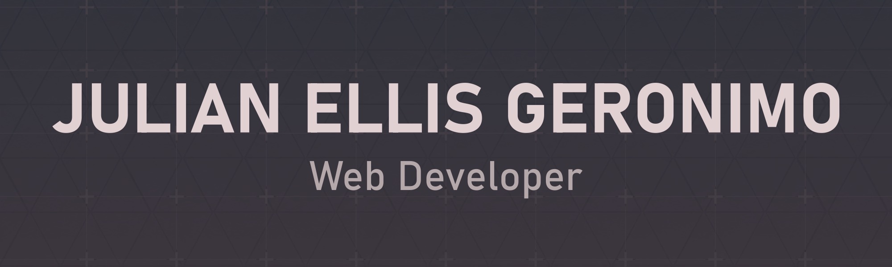

 &nbsp;

    <h1>About Me</h1>
    

        Hello! My name is Julian and I am a <u>web developer</u> who tries to make niche things. From remakes of things to cater to my specific needs, to things that don't exist yet. I use AI as an assistant to help fill in gaps in my workflow without crutching on it.
    
 &nbsp;
    <h1>Technical Skills</h1>

<table>
  <tr>
    <td style="font-size: 16px;" align="left" valign="top" width="190"><strong>Languages:</strong></td>
    <td align="left">
      
      
      
      
      
      
      
      
      
    </td>

  </tr>
  <tr>
    <td style="font-size: 16px;" align="left" valign="top" width="190"><strong>Frameworks &amp; Libraries:</strong></td>
    <td align="left">
      
      
      
      
    </td>
  </tr>
  <tr>
    <td style="font-size: 16px;" align="left" valign="top" width="190"><strong>Tools:</strong></td>
    <td align="left">
      
      
      
      
      
      
       
      
      
      
      
    </td>
  </tr>
</table> 

    

&nbsp;

    <h1>Interests/Hobbies</h1>
    <ul>
        <li>Video Games! </li>
        <ul>
            <li>Competitive games like League of Legends.</li>
            <li>Hard games like Sekiro, Elden Ring, Touhou, and God of War.</li>
            <li>Exploration/Sandbox games like Terraria and Minecraft.</li>
        </ul>
        <li>Snowboarding 🏂</li>
        <li>Digital Art 🎨</li>
        <li>DIY Woodworking 📐</li>
        <li>Cooking 👨‍🍳</li>
        <li>Average Gym-goer / Casual Fitness 💪</li>
    </ul>

